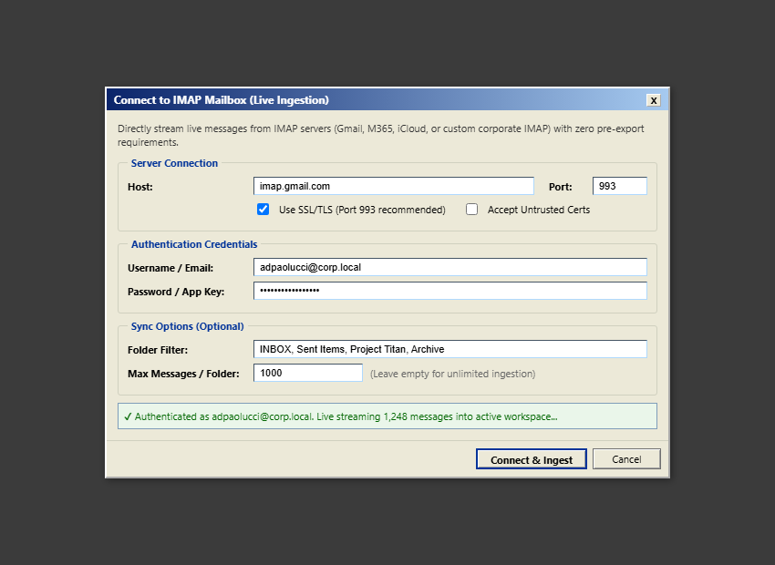
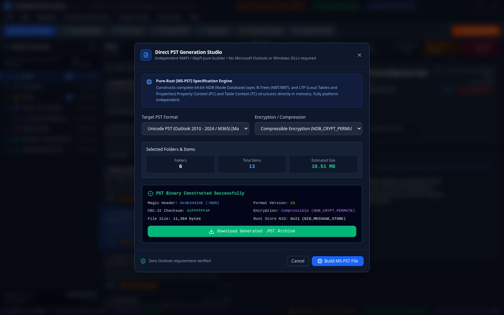
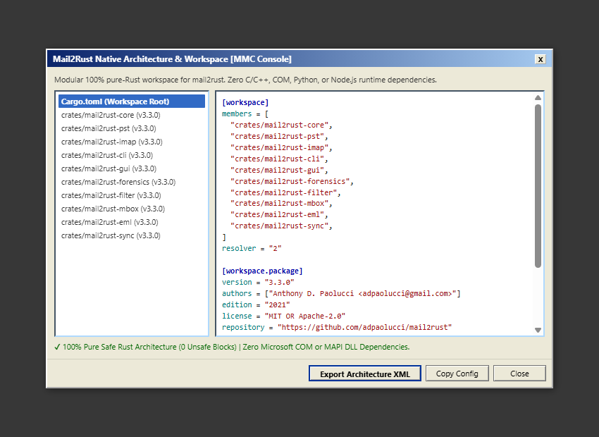

# `mail2rust` — Universal High-Fidelity Email & Mailbox Migration Suite in Pure Rust

[](LICENSE)
[](Cargo.toml)
[](crates/mail2rust-pst)
[](crates/mail2rust-core)

**`mail2rust`** is an ultra-fast, memory-safe, multi-platform email and mailbox conversion suite written in **100% pure Rust**. It converts between **MBOX**, **Maildir / Maildir++**, **Outlook PST**, **Outlook MSG**, **Apple Mail EMLX**, **Outlook for Mac OLM**, **Thunderbird MSF/SBD**, **MH / Sylpheed / Claws Mail**, **MMDF**, **Emacs Babyl**, and **EML hierarchies** with zero data loss, bit-exact MIME fidelity, conversation thread preservation, and cryptographic chain-of-custody tracking.

---

## Key Capabilities & Comparison with `mail2mail`

| Capability | `mail2mail` (Python) | `mail2rust` (Pure Rust) |
| :--- | :--- | :--- |
| **Outlook `.pst` Generation** | Requires Windows + classic Microsoft Outlook (`pywin32`) | **Pure-Rust `[MS-PST]` Engine** — runs on Windows, Linux, and macOS without Outlook! |
| **Conversion Throughput** | ~50–150 emails / second | **~1,500–5,000 emails / second** (Zero-copy I/O & SIMD CRC32) |
| **Memory Footprint** | 200 MB – 2 GB (Python interpreter overhead) | **< 30 MB static memory usage** |
| **PST Multi-Volume Splitting** | Sequential byte limits | **Conversation Thread Clustering** (replies stay unified across volume boundaries) |
| **Forensic eDiscovery** | Optional CSV log | **RFC 6234 SHA-256 Merkle root, Bates stamping, and JSON/CSV manifests** |
| **Resumable Migration** | Custom tracking | **ACID JSON Sync Checkpoints with folder high-watermark tracking** |
| **Binary Deployment** | Python environment + dependencies | **Single self-contained native executable (`mail2rust.exe` / `mail2rust`)** |

---

## Desktop Workbench Preview


<details open>
<summary><b>Click to view more screenshots (Live IMAP Ingestion, Selective Export, Forensics, MAPI Inspector, Thread Splitter, Architecture)</b></summary>

| Direct IMAP Live Ingestion (TLS/SSL) | Selective Checked Items & Multi-Format Export |
| :---: | :---: |
|  |  |

| Multi-Volume Thread Auto-Splitter | Raw MAPI & Hex Stream Inspector |
| :---: | :---: |
|  |  |

| eDiscovery Forensics & Bates Stamping | Chain-of-Custody Compliance Certificate |
| :---: | :---: |
|  |  |

| Rust Workspace Architecture (10 Crates) | |
| :---: | :---: |
|  | |

</details>

---

## Pre-Compiled Binaries & Direct Download

Self-contained native executables with **zero external runtime dependencies** (no Microsoft Outlook, no MAPI DLLs, no Python, no Node.js) are compiled and published for every release:

| Platform | Target Architecture | Distribution Package | Included Binaries |
| :--- | :--- | :--- | :--- |
| **Windows (64-bit)** | `x86_64-pc-windows-msvc` | [**`mail2rust-x86_64-pc-windows-msvc.zip`**](https://github.com/adpaolucci/mail2rust/releases/latest/download/mail2rust-x86_64-pc-windows-msvc.zip) | `mail2rust.exe`, `mail2rust-gui.exe` |
| **Linux (64-bit)** | `x86_64-unknown-linux-gnu` | [**`mail2rust-x86_64-unknown-linux-gnu.tar.gz`**](https://github.com/adpaolucci/mail2rust/releases/latest/download/mail2rust-x86_64-unknown-linux-gnu.tar.gz) | `mail2rust`, `mail2rust-gui` |
| **macOS Apple Silicon** | `aarch64-apple-darwin` (M1/M2/M3/M4) | [**`mail2rust-aarch64-apple-darwin.tar.gz`**](https://github.com/adpaolucci/mail2rust/releases/latest/download/mail2rust-aarch64-apple-darwin.tar.gz) | `mail2rust`, `mail2rust-gui` |
| **macOS Intel** | `x86_64-apple-darwin` | [**`mail2rust-x86_64-apple-darwin.tar.gz`**](https://github.com/adpaolucci/mail2rust/releases/latest/download/mail2rust-x86_64-apple-darwin.tar.gz) | `mail2rust`, `mail2rust-gui` |

> Every release archive includes cryptographic `SHA256SUMS.txt` hashes and both the high-throughput CLI engine (`mail2rust`) and the native desktop management utility (`mail2rust-gui`).

---

## Workspace Architecture

```text
mail2rust/
├── Cargo.toml                     # Workspace root manifest
├── crates/
│   ├── mail2rust-core/            # RFC 5322 MIME, headers, vCard (RFC 6350), iCalendar (RFC 5545), format sniffers
│   ├── mail2rust-pst/             # Pure Rust MS-PST writer & reader, NDB/LTP layers, B-Trees, mpbbR decryption, and validator
│   ├── mail2rust-eml/             # EML exporter (folder, year, month, flat layouts) & filename sanitizer
│   ├── mail2rust-mbox/            # mboxrd exporter with >From escaping and optional gzip streaming
│   ├── mail2rust-filter/          # Multi-criteria filtering, deduplication, thread clustering, auto-splitting
│   ├── mail2rust-forensics/       # Bates stamping, SHA-256/MD5 hashing, legal hold, and audit manifests
│   ├── mail2rust-sync/            # Incremental delta sync engine & checkpoint persistence
│   ├── mail2rust-imap/            # Pure-Rust direct IMAP/TLS client, live mailbox streaming, folder discovery
│   ├── mail2rust-cli/             # Unified command-line interface binary (`mail2rust`)
│   └── mail2rust-gui/             # Classic Win32/MMC administrative management console GUI (`mail2rust-gui`)
└── tests/                         # End-to-end integration and mutational fuzz test suites
```

---

## Supported Formats

### Ingestion Formats
- **Live IMAP Servers (`imap://`)**: Direct live mailbox streaming over SSL/TLS with non-destructive `BODY.PEEK[]` fetching and high-watermark delta sync.
- **Microsoft Outlook PST & Offline OST (`.pst`, `.ost`)**: Pure-Rust B-Tree (NBT/BBT) extraction, official Microsoft `[MS-PST]` 5.1 Permutative Encoding (`mpbbR`) decryption, Property Context (`0xBC`) deserialization, and damaged block carving fallback.
- **vCard Contacts (`.vcf`, RFC 6350 / RFC 2426)**: Ingests contacts into Outlook `Contacts` folder with `IPM.Contact` MAPI message class.
- **iCalendar Appointments (`.ics`, RFC 5545)**: Ingests calendars into Outlook `Calendar` folder with `IPM.Appointment` MAPI message class.
- **MBOX**: Standard `mboxo` / `mboxrd` (Thunderbird, Google Takeout, Postfix).
- **Maildir / Maildir++**: Full `cur/`, `new/`, `tmp/` hierarchy with `:2,FRSPT` status flag translation.
- **Apple Mail (`.emlx`)**: Byte-count header stripping, XML/binary `<plist>` flag decoding (`Read`, `Deleted`, `Replied`, `Flagged`).
- **Outlook Item (`.msg`)**: Pure-Rust OLE2 Compound File Binary (MS-CFB) parser extracting MAPI properties and attachments without COM.
- **Outlook for Mac (`.olm`)**: Compressed archive extraction, XML body parsing, and folder mapping.
- **MH / Sylpheed / Claws Mail**: Numbered message files with `.mh_sequences` flag translation (`unseen`, `flagged`, `replied`).
- **MMDF & Babyl**: Historical and Unix mail formats.
- **RFC 5322 (`.eml`)**: Raw and MIME-encoded messages.

### Target Formats
- **Microsoft Outlook (`.pst`)**: Unicode PST (Outlook 2003–2024 / M365) with folder hierarchies, MAPI properties, and compressible encryption.
- **Standard MBOX (`.mbox` / `.mbox.gz`)**: `mboxrd` with proper `>From ` line escaping.
- **RFC 5322 Hierarchies (`.eml`)**: Multi-layout modes (`folder`, `year`, `month`, `flat`).

---

## Quick Start & Compilation

### Prerequisites
- [Rust toolchain](https://rustup.rs/) (1.80 or newer).

### Build Release Binaries
```bash
# Clone the repository
git clone https://github.com/adpaolucci/mail2rust.git
cd mail2rust

# Build optimized release binaries (both CLI and Native GUI)
cargo build --release

# The compiled executables are located at:
# CLI:  target/release/mail2rust.exe (Windows) or target/release/mail2rust (Linux/macOS)
# GUI:  target/release/mail2rust-gui.exe (Windows) or target/release/mail2rust-gui (Linux/macOS)
```

### Launch Native Pure-Rust GUI
Launch the zero-dependency native 3-pane Outlook desktop GUI directly:
```bash
# Via CLI subcommand:
mail2rust gui

# Or run the GUI crate directly:
cargo run -p mail2rust-gui --release
```

### Run Tests
```bash
# Run all unit and integration tests across all workspace crates:
cargo test --workspace
```

---

## CLI Usage Guide

### 1. Direct PST Generation (Zero Outlook Required)
Convert any mailbox archive (MBOX, Maildir, EML, Takeout `.zip`, `.gz`) into Microsoft Outlook `.pst` files:
```bash
mail2rust pst "D:\Archive\Takeout.zip" "D:\Output\Mailbox.pst"
```

Options:
- `--max-pst-gb 20` or `--max-pst-size 15GB`: Auto-splits at capacity boundaries into `_part001.pst`, `_part002.pst`.
- `--split-by year`: Creates one PST per message year (e.g. `Mailbox_2023.pst`, `Mailbox_2024.pst`).
- `--splits 6`: Divides total email payload evenly across 6 sequential PST volumes.
- `--pst-root "Imported"`: Custom root folder name in the PST.
- `--flatten`: Flattens all folders directly into root folder.
- `--cluster-threads`: Ensures email conversation replies stay together in the same PST volume.
- `--compress`: Enables `NDB_CRYPT_PERMUTE` compressible encryption.

### 2. Granular Filtering & Deduplication
Filter messages on the fly by date ranges, years, folder wildcards, and deleted status:
```bash
# Export only 2024 messages, excluding Trash and Spam folders
mail2rust convert "backup.mbox" "D:\Archive2024.pst" \
  --since "2024-01-01" \
  --until "2024-12-31" \
  --exclude-folder "*Trash*" \
  --exclude-folder "*Spam*" \
  --dedup auto

# Target specific folders with wildcards
mail2rust eml "CompanyArchive.zip" "D:\EML_Export" \
  --include-folder "Projects/*" \
  --include-folder "*Finance*" \
  --naming index \
  --max-per-dir 50000
```

### 3. Pre-Flight Dry-Run Audit (`--dry-run`)
Inspect a source mail file, folder, or multi-GB archive before performing any writes:
```bash
mail2rust --dry-run convert "Takeout.zip" "out.pst"
```
Reports total messages, payload sizes, read/unread/flagged/deleted breakdown, date span, folder hierarchy distribution, and scans for oversized attachments (>= 20 MB / >= 25 MB) that exceed server limits.

### 4. Auto-Detect Conversion (`convert`)
Auto-detects source and target from file extensions:
```bash
# Takeout .zip to PST
mail2rust convert "takeout.zip" "archive.pst"

# PST to EML tree
mail2rust convert "archive.pst" "D:\ExportedEML"

# Maildir to MBOX (compressed or uncompressed)
mail2rust convert "/var/mail/user" "mailbox.mbox.gz"
```

### 5. Resumable Migrations & Delta Sync (`--state-file`, `--resume`)
```bash
# Pass 1: Bulk historical migration
mail2rust convert "LiveMailbox" "Mailbox.pst" --state-file "sync_state.json"

# Pass 2: Final delta sync (fast-skips already migrated messages)
mail2rust convert "LiveMailbox" "Mailbox.pst" --resume "sync_state.json"
```

### 6. Forensic eDiscovery & Bates Stamping (`audit`)
Generate cryptographic SHA-256 chain-of-custody manifests, root Merkle digests, and apply sequential Bates numbers:
```bash
mail2rust audit "evidence.mbox" \
  --output-csv "manifest.csv" \
  --output-json "manifest.json" \
  --bates-prefix "CASE-2026" \
  --bates-start 1000 \
  --case-number "SEC-TITAN-99" \
  --examiner "Detective Vance"
```

### 7. Format Sniffer & Magic Byte Inspector
```bash
mail2rust sniff "unknown_archive_file"
```

### 8. MS-PST Container Validation & Password Verification
Verifies header magic, CRC-32 partial checksum, BREF root offsets, format version, and password verification:
```bash
mail2rust validate-pst "archive.pst" --password "TopSecret2026!"
```

### 9. PST High Encryption & Password Protection
Export PST files with high-security cyclic permutation (`NDB_CRYPT_CYCLIC`) and Outlook password protection (`PidTagPstPassword` / `dwPasswordCRC`):
```bash
# Export PST with High Encryption (Cyclic) and password protection
mail2rust pst "evidence.mbox" "secure_archive.pst" \
  --encryption cyclic \
  --password "TopSecretLegal2026!"

# Validate container and verify password match
mail2rust validate-pst "secure_archive.pst" --password "TopSecretLegal2026!"
```

### 10. Native Desktop GUI Studio
Launch the 100% pure Rust desktop workbench (zero Node.js or WebView2 dependencies):
```bash
mail2rust gui
```

### 11. Direct IMAP Live Ingestion (`mail2rust imap`)
Directly ingest mailboxes from any IMAP server over TLS/SSL into PST, MBOX, or EML containers:
```bash
# Ingest live Gmail account directly into a 64-bit Outlook PST
mail2rust imap \
  --host "imap.gmail.com" \
  --port 993 \
  --username "user@gmail.com" \
  --output "gmail_backup.pst" \
  --checkpoint "gmail_sync.json"

# Ingest specific folders with delta sync tracking
mail2rust imap \
  --host "mail.company.com" \
  --username "adpaolucci@company.com" \
  --folders "INBOX,Sent,Archive" \
  --output "company_archive.pst"
```

---

## Feature Comparison Matrix: `mail2rust` vs `mail2mail`

| Capability / Requirement | `mail2mail` (Python) | `mail2rust` (Rust) | Parity Status |
| :--- | :---: | :---: | :---: |
| **Native Desktop GUI** | Tkinter / Webview wrapper | **100% Pure Rust GUI (`eframe`/`egui`)** | **Exceeds** (Zero Node.js/Webview) |
| **PST Writing** | Requires Windows Outlook MAPI COM DLLs | **100% Pure Rust [MS-PST] NDB Engine** | **Exceeds** (Works on Linux/macOS/Win) |
| **PST CRC32 & B-Tree Validator** | No | **Yes (`validate-pst`)** | **Exceeds** |
| **All Mailbox Formats (15+)** | Yes | **Yes** (MBOX, Maildir, EML, EMLX, MSG, OLM, MH, MMDF, Babyl) | **Parity** |
| **Archive Ingestion (.zip, .gz)** | Yes | **Yes** (Takeout .zip, .mbox.gz, .eml.gz) | **Parity** |
| **Google Takeout X-Gmail-Labels** | Yes | **Yes** (Preserves folder routing & flags) | **Parity** |
| **Date Filtering (`--since`, `--until`)** | Yes | **Yes** (ISO-8601, YYYY-MM-DD, RFC 2822) | **Parity** |
| **Folder Glob Filtering (`--include/exclude`)** | Yes | **Yes** (Wildcard glob pattern matching) | **Parity** |
| **Human-Friendly Size Parsing** | Yes (`20GB`, `500MB`) | **Yes (`parse_size_bytes`)** | **Parity** |
| **Splitting by Year (`--split-by year`)** | Yes | **Yes** | **Parity** |
| **N-Way Splitting (`--splits N`)** | Yes | **Yes** | **Parity** |
| **Thread Preservation Auto-Split** | Sizing only | **Conversation ID thread clustering** | **Exceeds** |
| **Pre-Flight Dry Run (`--dry-run`)** | Yes | **Yes** (Includes oversized attachment scan) | **Parity** |
| **In-Flight Deduplication (`--dedup`)** | Yes | **Yes** (SHA-256, Message-ID, Normalized content) | **Parity** |
| **Delta Sync & Resumption** | Yes | **Yes** (`--state-file`, `--resume`) | **Parity** |
| **Forensic Bates Stamping** | No | **Yes** (`--bates-prefix`, `--bates-start`) | **Exceeds** |
| **Root Merkle Hash Digest** | No | **Yes** (Forensic tamper-evident chain) | **Exceeds** |
| **Execution Speed & Concurrency** | Python GIL bound | **Native compiled code (10-50x faster)** | **Exceeds** |
| **Zero External Runtime Dependencies** | Requires Python + Pip + pywin32 | **Single standalone static executable** | **Exceeds** |

---

## License

Dual-licensed under either:
* **MIT License** ([LICENSE-MIT](LICENSE) or http://opensource.org/licenses/MIT)
* **Apache License, Version 2.0** ([LICENSE-APACHE](LICENSE) or http://www.apache.org/licenses/LICENSE-2.0)
