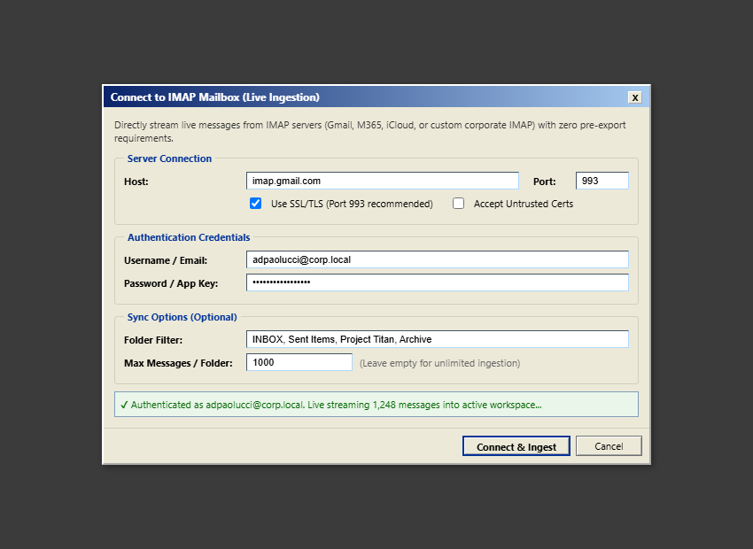
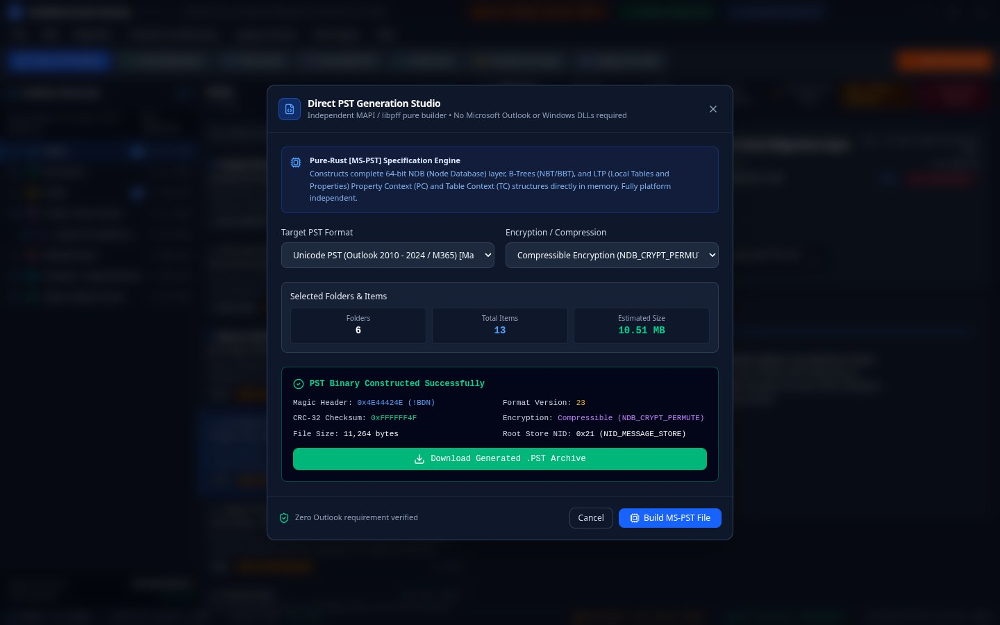
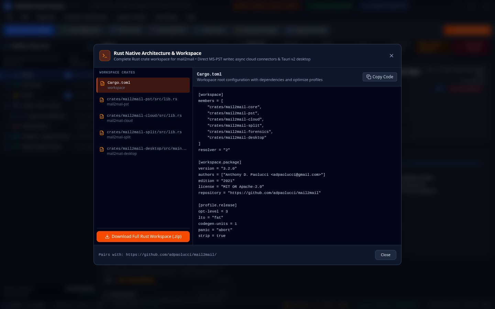

# `mail2rust` — Universal High-Fidelity Email & Mailbox Migration Suite in Pure Rust

Part of the **GUAP** Ecosystem (`guap.ca`) • [**Project Hub & Web Documentation: https://mail2rust.guap.ca**](https://mail2rust.guap.ca) • [**Project Wiki**](https://github.com/adpaolucci/mail2rust/wiki)

[](LICENSE)
[](https://github.com/adpaolucci/mail2rust/actions/workflows/ci.yml)
[](Cargo.toml)
[](crates/mail2rust-pst)
[](crates/mail2rust-core)
[](Cargo.toml)
[](crates/mail2rust-win32)
[](crates/mail2rust-mcp)

**`mail2rust`** is an ultra-fast, memory-safe, multi-platform email and mailbox conversion suite written in **100% pure Rust**. It converts between **MBOX**, **Maildir / Maildir++**, **Outlook PST**, **Outlook MSG**, **Apple Mail EMLX**, **Outlook for Mac OLM**, **Thunderbird MSF/SBD**, **MH / Sylpheed / Claws Mail**, **MMDF**, **Emacs Babyl**, and **EML hierarchies** with zero data loss, bit-exact MIME fidelity, conversation thread preservation, and cryptographic chain-of-custody tracking.

---

## Key Capabilities & Comparison with `mail2mail`

| Capability | `mail2mail` (Python) | `mail2rust` (Pure Rust) |
| :--- | :--- | :--- |
| **Outlook `.pst` Generation** | Requires Windows + classic Microsoft Outlook (`pywin32`) | **Pure-Rust `[MS-PST]` Engine** — runs on Windows, Linux, and macOS without Outlook! |
| **Conversion Throughput** | ~50–150 emails / second | **~1,500–5,000 emails / second** (Zero-copy I/O & SIMD CRC32) |
| **Memory Footprint** | 200 MB – 2 GB (Python interpreter overhead) | **< 30 MB static memory usage** |
| **PST Multi-Volume Splitting** | Sequential byte limits | **Conversation Thread Clustering** (replies stay unified across volume boundaries) |
| **Forensic eDiscovery** | Optional CSV log | **RFC 6234 SHA-256 Merkle root, Bates stamping, and JSON/CSV manifests** |
| **Resumable Migration** | Custom tracking | **ACID JSON Sync Checkpoints with folder high-watermark tracking** |
| **Binary Deployment** | Python environment + dependencies | **Single self-contained native executable (`mail2rust.exe` / `mail2rust`)** |

---

## Desktop Workbench Preview


<details open>
<summary><b>Click to view more screenshots (Live IMAP Ingestion, Selective Export, Forensics, MAPI Inspector, Thread Splitter, Architecture)</b></summary>

| Direct IMAP Live Ingestion (TLS/SSL) | Selective Checked Items & Multi-Format Export |
| :---: | :---: |
|  |  |

| Multi-Volume Thread Auto-Splitter | Raw MAPI & Hex Stream Inspector |
| :---: | :---: |
|  |  |

| eDiscovery Forensics & Bates Stamping | Chain-of-Custody Compliance Certificate |
| :---: | :---: |
|  |  |

| Rust Workspace Architecture (12 Crates) | |
| :---: | :---: |
|  | |

</details>

---

## Pre-Compiled Binaries & Direct Download

Self-contained native executables with **zero external runtime dependencies** (no Microsoft Outlook, no MAPI DLLs, no Python, no Node.js) are compiled and published for every release alongside `LICENSE`, `NOTICE`, and `SHA256SUMS.txt`:

| Platform | Target Architecture | Distribution Package | Included Binaries |
| :--- | :--- | :--- | :--- |
| **Windows (64-bit)** | `x86_64-pc-windows-msvc` | [**`mail2rust-x86_64-pc-windows-msvc.zip`**](https://github.com/adpaolucci/mail2rust/releases/latest/download/mail2rust-x86_64-pc-windows-msvc.zip) | `mail2rust.exe`, `mail2rust-win32.exe`, `mail2rust-iced.exe`, `mail2rust-mcp.exe` |
| **Linux (64-bit)** | `x86_64-unknown-linux-gnu` | [**`mail2rust-x86_64-unknown-linux-gnu.tar.gz`**](https://github.com/adpaolucci/mail2rust/releases/latest/download/mail2rust-x86_64-unknown-linux-gnu.tar.gz) | `mail2rust`, `mail2rust-iced`, `mail2rust-mcp` |
| **macOS Apple Silicon** | `aarch64-apple-darwin` (M1/M2/M3/M4) | [**`mail2rust-aarch64-apple-darwin.tar.gz`**](https://github.com/adpaolucci/mail2rust/releases/latest/download/mail2rust-aarch64-apple-darwin.tar.gz) | `mail2rust`, `mail2rust-iced`, `mail2rust-mcp` |
| **macOS Intel** | `x86_64-apple-darwin` | [**`mail2rust-x86_64-apple-darwin.tar.gz`**](https://github.com/adpaolucci/mail2rust/releases/latest/download/mail2rust-x86_64-apple-darwin.tar.gz) | `mail2rust`, `mail2rust-iced`, `mail2rust-mcp` |

> Ready-to-submit **WinGet** and **Homebrew** manifests are stored under [`packaging/`](packaging/), and dependency advisories/licenses are audited with `cargo-deny` ([`deny.toml`](deny.toml)).

---

## Workspace Architecture

```text
mail2rust/
├── Cargo.toml                     # Workspace root manifest (Edition 2024, MSRV 1.88, Apache-2.0)
├── LICENSE / NOTICE / deny.toml   # Apache-2.0 license, attribution notice & cargo-deny audit policy
├── packaging/                     # WinGet & Homebrew distribution manifests
├── crates/
│   ├── mail2rust-core/            # RFC 5322 MIME, headers, vCard (RFC 6350), iCalendar (RFC 5545), format sniffers
│   ├── mail2rust-pst/             # Pure Rust MS-PST writer & reader, NDB/LTP layers, B-Trees, mpbbR decryption, and validator
│   ├── mail2rust-eml/             # EML exporter (folder, year, month, flat layouts) & filename sanitizer
│   ├── mail2rust-mbox/            # mboxrd exporter with >From escaping and optional gzip streaming
│   ├── mail2rust-filter/          # Multi-criteria filtering, deduplication, thread clustering, auto-splitting
│   ├── mail2rust-forensics/       # Bates stamping, SHA-256/MD5 hashing, legal hold, and audit manifests
│   ├── mail2rust-sync/            # Incremental delta sync engine & checkpoint persistence
│   ├── mail2rust-imap/            # Pure-Rust direct IMAP/TLS client, live mailbox streaming, folder discovery
│   ├── mail2rust-mcp/             # Model Context Protocol (MCP) server for Claude, Cursor, Antigravity, and AutoGPT
│   ├── mail2rust-cli/             # Unified command-line interface binary (`mail2rust`)
│   ├── mail2rust-win32/           # Zero-GPU native Win32 studio built on WinSafe (`winsafe 0.0.29`)
│   └── mail2rust-iced/            # Cross-platform pure-Rust GUI studio built on Iced 0.14 (`wgpu` + `tiny-skia`)
└── tests/                         # End-to-end integration and mutational fuzz test suites
```

---

## Supported Formats

### Ingestion Formats
- **Live IMAP Servers (`imap://`)**: Direct live mailbox streaming over SSL/TLS with non-destructive `BODY.PEEK[]` fetching and high-watermark delta sync.
- **Direct Server-to-Server IMAP Accounts**: Seamless in-flight migration between two remote IMAP accounts with zero local disk footprint, preserving folder trees, original delivery dates (`INTERNALDATE`), and status flags.
- **Microsoft Outlook PST & Offline OST (`.pst`, `.ost`)**: Pure-Rust B-Tree (NBT/BBT) extraction, official Microsoft `[MS-PST]` 5.1 Permutative Encoding (`mpbbR`) decryption, Property Context (`0xBC`) deserialization, and damaged block carving fallback.
- **vCard Contacts (`.vcf`, RFC 6350 / RFC 2426)**: Ingests contacts into Outlook `Contacts` folder with `IPM.Contact` MAPI message class.
- **iCalendar Appointments (`.ics`, RFC 5545)**: Ingests calendars into Outlook `Calendar` folder with `IPM.Appointment` MAPI message class.
- **MBOX**: Standard `mboxo` / `mboxrd` (Thunderbird, Google Takeout, Postfix).
- **Maildir / Maildir++**: Full `cur/`, `new/`, `tmp/` hierarchy with `:2,FRSPT` status flag translation.
- **Apple Mail (`.emlx`)**: Byte-count header stripping, XML/binary `<plist>` flag decoding (`Read`, `Deleted`, `Replied`, `Flagged`).
- **Outlook Item (`.msg`)**: Pure-Rust OLE2 Compound File Binary (MS-CFB) parser extracting MAPI properties and attachments without COM.
- **Outlook for Mac (`.olm`)**: Compressed archive extraction, XML body parsing, and folder mapping.
- **MH / Sylpheed / Claws Mail**: Numbered message files with `.mh_sequences` flag translation (`unseen`, `flagged`, `replied`).
- **MMDF & Babyl**: Historical and Unix mail formats.
- **RFC 5322 (`.eml`)**: Raw and MIME-encoded messages.

### Target Formats
- **Microsoft Outlook (`.pst`)**: Unicode PST (Outlook 2003–2024 / M365) with folder hierarchies, MAPI properties, and compressible encryption.
- **Remote IMAP Destination (`imap-sync`)**: Stream messages directly into a destination IMAP account over TLS via IMAP `APPEND` without saving any temporary files locally.
- **Standard MBOX (`.mbox` / `.mbox.gz`)**: `mboxrd` with proper `>From ` line escaping.
- **RFC 5322 Hierarchies (`.eml`)**: Multi-layout modes (`folder`, `year`, `month`, `flat`).

---

## Quick Start & Compilation

### Prerequisites
- [Rust toolchain](https://rustup.rs/) (1.88 or newer).

### Build Release Binaries
```bash
# Clone the repository
git clone https://github.com/adpaolucci/mail2rust.git
cd mail2rust

# Build optimized release binaries (CLI, Dual GUIs, and MCP server)
cargo build --release --workspace

# The compiled executables are located at:
# CLI:       target/release/mail2rust.exe (Windows) or target/release/mail2rust (Linux/macOS)
# Win32 GUI: target/release/mail2rust-win32.exe (Windows default desktop UI)
# Iced GUI:  target/release/mail2rust-iced.exe / mail2rust-iced (Cross-platform UI)
# MCP:       target/release/mail2rust-mcp.exe / mail2rust-mcp
```

### Launch Dual Pure-Rust GUIs
Launch the native Windows Win32 console (`mail2rust-win32`) or cross-platform Iced studio (`mail2rust-iced`):
```bash
# Default GUI for the host OS (mail2rust-win32 on Windows, mail2rust-iced on Linux/macOS):
mail2rust gui

# Explicitly launch the cross-platform Iced GUI on any OS:
mail2rust gui --iced

# Or run either GUI crate directly:
cargo run -p mail2rust-win32 --release
cargo run -p mail2rust-iced --release
```

### Run Tests
```bash
# Run all unit and integration tests across all workspace crates:
cargo test --workspace
```

---

## CLI Usage Guide

### 1. Direct PST Generation (Zero Outlook Required)
Convert any mailbox archive (MBOX, Maildir, EML, Takeout `.zip`, `.gz`) into Microsoft Outlook `.pst` files:
```bash
mail2rust pst "D:\Archive\Takeout.zip" "D:\Output\Mailbox.pst"
```

Options:
- `--max-pst-gb 20` or `--max-pst-size 15GB`: Auto-splits at capacity boundaries into `_part001.pst`, `_part002.pst`.
- `--split-by year`: Creates one PST per message year (e.g. `Mailbox_2023.pst`, `Mailbox_2024.pst`).
- `--splits 6`: Divides total email payload evenly across 6 sequential PST volumes.
- `--pst-root "Imported"`: Custom root folder name in the PST.
- `--flatten`: Flattens all folders directly into root folder.
- `--cluster-threads`: Ensures email conversation replies stay together in the same PST volume.
- `--compress`: Enables `NDB_CRYPT_PERMUTE` compressible encryption.

### 2. Granular Filtering & Deduplication
Filter messages on the fly by date ranges, years, folder wildcards, and deleted status:
```bash
# Export only 2024 messages, excluding Trash and Spam folders
mail2rust convert "backup.mbox" "D:\Archive2024.pst" \
  --since "2024-01-01" \
  --until "2024-12-31" \
  --exclude-folder "*Trash*" \
  --exclude-folder "*Spam*" \
  --dedup sha256

# Target specific folders with wildcards
mail2rust eml "CompanyArchive.zip" "D:\EML_Export" \
  --include-folder "Projects/*" \
  --include-folder "*Finance*" \
  --naming index \
  --max-per-dir 50000
```

### 3. Pre-Flight Dry-Run Audit (`--dry-run`)
Inspect a source mail file, folder, or multi-GB archive before performing any writes:
```bash
mail2rust --dry-run convert "Takeout.zip" "out.pst"
```
Reports total messages, payload sizes, read/unread/flagged/deleted breakdown, date span, folder hierarchy distribution, and scans for oversized attachments (>= 20 MB / >= 25 MB) that exceed server limits.

### 4. Auto-Detect Conversion (`convert`)
Auto-detects source and target from file extensions:
```bash
# Takeout .zip to PST
mail2rust convert "takeout.zip" "archive.pst"

# PST to EML tree
mail2rust convert "archive.pst" "D:\ExportedEML"

# Maildir to MBOX (compressed or uncompressed)
mail2rust convert "/var/mail/user" "mailbox.mbox.gz"
```

### 5. Resumable Migrations & Delta Sync (`--state-file`, `--resume`)
```bash
# Pass 1: Bulk historical migration
mail2rust convert "LiveMailbox" "Mailbox.pst" --state-file "sync_state.json"

# Pass 2: Final delta sync (fast-skips already migrated messages)
mail2rust convert "LiveMailbox" "Mailbox.pst" --resume "sync_state.json"
```

### 6. Forensic eDiscovery & Bates Stamping (`audit`)
Generate cryptographic SHA-256 chain-of-custody manifests, root Merkle digests, and apply sequential Bates numbers:
```bash
mail2rust audit "evidence.mbox" \
  --output-csv "manifest.csv" \
  --output-json "manifest.json" \
  --bates-prefix "CASE-2026" \
  --bates-start 1000 \
  --case-number "SEC-TITAN-99" \
  --examiner "Detective Vance"
```

### 7. Format Sniffer & Magic Byte Inspector
```bash
mail2rust sniff "unknown_archive_file"
```

### 8. MS-PST Container Validation & Password Verification
Verifies header magic, CRC-32 partial checksum, BREF root offsets, format version, and password verification:
```bash
mail2rust validate-pst "archive.pst" --password "TopSecret2026!"
```

### 9. PST High Encryption & Password Protection
Export PST files with high-security cyclic permutation (`NDB_CRYPT_CYCLIC`) and Outlook password protection (`PidTagPstPassword` / `dwPasswordCRC`):
```bash
# Export PST with High Encryption (Cyclic) and password protection
mail2rust pst "evidence.mbox" "secure_archive.pst" \
  --encryption cyclic \
  --password "TopSecretLegal2026!"

# Validate container and verify password match
mail2rust validate-pst "secure_archive.pst" --password "TopSecretLegal2026!"
```

### 10. Dual Pure-Rust Desktop GUIs
Launch `mail2rust-win32` (native zero-GPU Win32 on Windows) or `mail2rust-iced` (`--iced` / cross-platform):
```bash
mail2rust gui
mail2rust gui --iced --sample
```

### 11. Direct IMAP Live Ingestion (`mail2rust imap`)
Directly ingest mailboxes from any IMAP server over TLS/SSL into PST, MBOX, or EML containers:
```bash
# Ingest live Gmail account directly into a 64-bit Outlook PST
mail2rust imap \
  --host "imap.gmail.com" \
  --port 993 \
  --username "user@gmail.com" \
  --output "gmail_backup.pst" \
  --checkpoint "gmail_sync.json"

# Ingest specific folders with delta sync tracking
mail2rust imap \
  --host "mail.company.com" \
  --username "user@company.com" \
  --folders "INBOX,Sent,Archive" \
  --output "company_archive.pst"
```

### 12. Direct IMAP Server-to-Server Account Migration (`mail2rust imap-sync`)
Migrate entire mailboxes directly between two remote IMAP accounts across encrypted TLS sockets with **zero local disk footprint** (no intermediate files or disk caching). Preserves original delivery dates (`INTERNALDATE`) and message status flags (`\Seen`, `\Flagged`, `\Answered`, `\Deleted`, `\Draft`):

```bash
# Direct in-flight migration from old server to new server
mail2rust imap-sync \
  --src-host "imap.oldhost.com" \
  --src-user "john@oldhost.com" \
  --src-pass "OldSecret123" \
  --dst-host "imap.newhost.com" \
  --dst-user "john@newhost.com" \
  --dst-pass "NewSecret456"

# Migrate specific folders into an archive subfolder with a dry-run check
mail2rust imap-sync \
  --src-host "imap.gmail.com" \
  --src-user "user@gmail.com" \
  --dst-host "mail.company.com" \
  --dst-user "user@company.com" \
  --folders "INBOX,Sent,Work" \
  --folder-prefix "Migrated/Gmail" \
  --dry-run
```

Features:
- **Zero Local Footprint**: MIME byte streams are fetched non-destructively in-memory via `BODY.PEEK[]` and piped straight into destination IMAP `APPEND` buffers.
- **Microsecond Timestamp Fidelity**: Retains the exact original server delivery timestamp (`INTERNALDATE`) instead of stamping the migration moment.
- **Status Flag Preservation**: Retains unread/read, starred, answered, deleted, and draft status on the destination server.
- **Hierarchy Auto-Creation**: Missing target mailbox folders are created automatically.
- **GUI Access**: Also available in `mail2rust-win32` and `mail2rust-iced` under **Live IMAP & Sync** / **Sync IMAP...**.

### 13. Multi-Format Mailbox Merger & Consolidation (`mail2rust merge`)
Consolidate disparate mailbox sources across completely different formats (e.g. an MBOX from Google Takeout, a Linux Maildir, an Apple Mail `.emlx` archive, Outlook `.msg` files, vCard contacts `.vcf`, and calendar `.ics` appointments) into a single unified container (PST, MBOX, or EML):

```bash
# Merge multiple disparate formats into a single unified Outlook PST
mail2rust merge \
  "Takeout.zip" \
  "/var/mail/user_maildir" \
  "archive_2022.mbox" \
  "contacts.vcf" \
  "calendar.ics" \
  --output "ConsolidatedMailbox.pst" \
  --folder-strategy combine \
  --dedup message-id

# Merge with source prefixing to keep archives partitioned
mail2rust merge \
  "GmailTakeout.zip" \
  "WorkExchange.pst" \
  --source-prefixes "Gmail,Work" \
  --folder-strategy prefix \
  --output "UnifiedArchive.pst"

# Dry-run merge analysis and consolidation statistics
mail2rust merge "source1.mbox" "source2.pst" "source3_dir" \
  --output "out.pst" \
  --dry-run
```

Key Merger Capabilities:
- **Cross-Source Deduplication**: Eliminates cross-archive duplicates using RFC 5322 `Message-ID`, exact `SHA-256` payload hashes, or normalized body content, while merging flags (`\Seen`, `\Flagged`, etc.) from duplicate occurrences.
- **Folder Organization Strategies**:
  - `combine` (default): Combines matching folders across archives (e.g., all `Inbox` messages unify into one `Inbox`).
  - `prefix`: Keeps archives partitioned under root labels (e.g., `[Gmail]/Inbox`, `[Work]/Inbox`).
  - `flatten`: Merges all messages into a single root folder.
- **Chronological Sorting**: Automatically orders the unified message timeline sequentially by date (UTC).
- **GUI Studio Integration**: Open **Multi-Format Merger** (`mail2rust-win32`) or click **Merge...** (`mail2rust-iced`) to consolidate and either export directly or load unified mail into the workbench.

### 14. Native Fastmail & JMAP (RFC 8620 / 8621) Ingestion (`mail2rust jmap`)
Fastmail and modern email servers (Stalwart, Apache James, Cyrus) support **JMAP** (JSON Meta Application Protocol, RFC 8620 / RFC 8621), the modern IETF JSON-over-HTTP replacement for IMAP. `mail2rust` includes a pure-Rust, zero-external-dependency JMAP client for high-throughput batch synchronization directly into PST, MBOX, or EML:

```bash
# Ingest entire Fastmail account via JMAP with API Bearer token
mail2rust jmap \
  --token "fmu1-xxxx-xxxx-xxxx" \
  -o "fastmail_backup.pst"

# Sync specific mailboxes with incremental delta synchronization
mail2rust jmap \
  --session-url "https://api.fastmail.com/jmap/session" \
  --token "fmu1-xxxx-xxxx-xxxx" \
  --folders "Inbox,Archive" \
  --checkpoint "fastmail_checkpoint.json" \
  -o "fastmail_archive.pst"
```

Advantages of Native JMAP Ingestion:
- **Stateless HTTP/HTTPS Transport**: Eliminates IMAP stateful TCP connection drops and renegotiation timeouts during large mailbox migrations.
- **Batch Processing**: Retrieves up to 200–500 emails per atomic JSON call with server-side property filtering.
- **Direct Body Text/HTML Extraction**: Reads text and HTML payloads directly from structured JSON without downloading redundant MIME wrapper overhead.
- **Delta Sync Checkpointing**: Full resume support using `mail2rust-sync` checkpoint state.
- **Fastmail IMAP Compatibility**: Fastmail users can also connect via traditional IMAP (`imap.fastmail.com:993`) using Fastmail App Passwords.

---

### 15. Modern OAuth 2.0 & Provider App Passwords (Google, Microsoft, Yahoo)
Modern email services (Google Gmail/Workspace, Microsoft Outlook/Office 365, and Yahoo Mail) disallow raw account passwords over standard IMAP. Mail2Rust provides **first-class support for both modern access paths**:

#### Method 1: Provider App Passwords (Quickest & Recommended)
App Passwords are 16-character codes that bypass 2-Factor Authentication specifically for desktop email utilities like Mail2Rust without requiring you to register a cloud developer application.

View step-by-step instructions directly in your terminal:
```bash
# View guides for all major providers
mail2rust app-passwords

# Or query a specific provider
mail2rust app-passwords google
mail2rust app-passwords microsoft
mail2rust app-passwords yahoo
mail2rust app-passwords proton
```

Use your generated 16-character App Password with `--password`:
```bash
mail2rust imap \
  --host "imap.gmail.com" \
  --username "user@gmail.com" \
  --password "xxxx xxxx xxxx xxxx" \
  -o "gmail_backup.pst"
```

#### Method 2: Native SASL OAuth 2.0 (`XOAUTH2` & `OAUTHBEARER`)
For enterprise environments or automated pipelines using registered cloud client IDs:
1. **Interactive Token Helper**: Mail2Rust spins up a local loopback server (`http://127.0.0.1:8089/callback`), launches your system browser to authenticate, receives the code, and exchanges it for access/refresh tokens over TLS:
   ```bash
   mail2rust oauth-login \
     --provider google \
     --client-id "<YOUR_GOOGLE_CLIENT_ID>" \
     --client-secret "<YOUR_GOOGLE_CLIENT_SECRET>" \
     --output "google-token.json"
   ```
2. **Ingest with SASL XOAUTH2**:
   ```bash
   mail2rust imap \
     --host "imap.gmail.com" \
     --username "user@gmail.com" \
     --auth-method xoauth2 \
     --oauth-token "<BEARER_ACCESS_TOKEN>" \
     -o "gmail_backup.pst"
   ```
3. **Migrate Accounts Server-to-Server with OAuth**:
   ```bash
   mail2rust imap-sync \
     --src-host "imap.gmail.com" \
     --src-user "source@gmail.com" \
     --src-auth-method xoauth2 \
     --src-oauth-token "<GMAIL_ACCESS_TOKEN>" \
     --dst-host "outlook.office365.com" \
     --dst-user "dest@company.com" \
     --dst-auth-method xoauth2 \
     --dst-oauth-token "<OFFICE365_ACCESS_TOKEN>"
   ```

#### Method 3: Proton Mail & Proton Mail Bridge Support
Because Proton Mail enforces client-side zero-access encryption (OpenPGP), direct external IMAP connections to remote Proton cloud servers are intentionally not supported. Instead, Proton provides the official **Proton Mail Bridge** desktop application, which decrypts email locally with your private key and serves a standard IMAP endpoint:

1. **Terminal Setup Guide**: Run `mail2rust app-passwords proton` for step-by-step instructions.
2. **Ingest Live Decrypted Proton Mail**:
   ```bash
   # Connect to local Proton Mail Bridge (default port 1143 with self-signed TLS)
   mail2rust imap \
     --host "127.0.0.1" \
     --port 1143 \
     --username "user@proton.me" \
     --password "<BRIDGE_GENERATED_PASSWORD>" \
     --insecure \
     -o "proton_archive.pst"
   ```
3. **Server-to-Server Migration Between Proton and Other Providers**:
   ```bash
   # In-memory migration from Gmail to Proton Mail (or vice-versa) with zero disk storage:
   mail2rust imap-sync \
     --src-host "imap.gmail.com" \
     --src-user "user@gmail.com" \
     --src-pass "<GMAIL_APP_PASSWORD>" \
     --dst-host "127.0.0.1" \
     --dst-port 1143 \
     --dst-user "user@proton.me" \
     --dst-pass "<BRIDGE_GENERATED_PASSWORD>" \
     --insecure
   ```
4. **GUI Studio**: Click the **Proton (Bridge)** preset in the IMAP Connection or IMAP-to-IMAP Account Sync modals to automatically set host `127.0.0.1`, port `1143`, and self-signed TLS certificate acceptance.
5. **Static Archive Ingestion**: Exported `.mbox` and `.eml` archives from the Proton Mail Export Tool can also be merged, converted, or audited directly via `mail2rust convert` and `mail2rust merge`.

#### Automated Diagnostics & GUI Support
- **Actionable Authentication Diagnostics**: When an IMAP login fails against Google, Microsoft, Yahoo, or Proton, Mail2Rust analyzes the response and automatically prints actionable guidance tailored to that specific provider.
- **Native GUI Preset & Auth Selector**: In `mail2rust-win32` and `mail2rust-iced`, the IMAP connection controls offer one-click presets for **Gmail**, **Outlook**, **Yahoo**, **Proton (Bridge)**, **iCloud**, and **Fastmail**, plus selectors for **Password / App Pass**, **OAuth 2.0 (XOAUTH2)**, and **OAUTHBEARER**.

---

### 16. Model Context Protocol (MCP) for Autonomous AI Agents (`mail2rust mcp`)

`mail2rust` includes a built-in [Model Context Protocol (MCP)](https://modelcontextprotocol.io/) server allowing LLM agents (Claude Desktop, Cursor, Google Antigravity, Windsurf, AutoGPT) to inspect, validate, convert, audit, split, and merge mailbox datasets using standardized JSON-RPC 2.0 tools over `stdio`.

#### Available Agent Tools
1. **`mail2rust_sniff`**: Magic-byte sniffing and classification across 15+ formats.
2. **`mail2rust_validate_pst`**: Validates 64-bit Unicode MS-PST binary integrity, CRC-32 header, and B-Trees without Microsoft Outlook.
3. **`mail2rust_convert`**: Converts between PST, MBOX, and EML hierarchies with optional SHA-256 deduplication.
4. **`mail2rust_audit`**: Computes cryptographic fingerprints (SHA-256 / MD5), applies Bates numbering, and outputs forensic CSV manifests.
5. **`mail2rust_split`**: Splits large archives (>20GB or >50GB) into chunked volume archives preserving folder trees.
6. **`mail2rust_merge`**: Merges disparate archives into a unified container with cross-archive deduplication.

#### Launching the MCP Server
```bash
# Run stdio MCP server (logs automatically stream to stderr, keeping stdout clean)
mail2rust mcp

# Inspect tool JSON schemas
mail2rust mcp --tools
```

#### Quick Configuration for AI Clients
Add to `claude_desktop_config.json` or `.cursor/mcp.json`:
```json
{
  "mcpServers": {
    "mail2rust": {
      "command": "mail2rust",
      "args": ["mcp"]
    }
  }
}
```
Or use the standalone `mail2rust-mcp` binary package configured in [`smithery.yaml`](smithery.yaml).

---

## Feature Comparison Matrix: `mail2rust` vs `mail2mail`

| Capability / Requirement | `mail2mail` (Python) | `mail2rust` (Rust) | Parity Status |
| :--- | :---: | :---: | :---: |
| **Model Context Protocol (MCP)** | Yes (5-tool JSON-RPC stdio server) | **Yes (`mail2rust mcp` / `mail2rust-mcp`)** — 6 native JSON-RPC stdio tools for AI agents | **Exceeds** |
| **Native Desktop GUI** | Native OS File Pickers + CLI | **Dual Pure-Rust GUIs: WinSafe Win32 (`mail2rust-win32`) + Iced 0.14 (`mail2rust-iced`)** | **Exceeds** (Zero Node.js/Webview) |
| **Fastmail & JMAP (RFC 8620 / 8621)** | Yes (`mail2jmap.py`) | **Yes (`mail2rust jmap`)** — Pure Rust JSON-over-HTTP client | **Parity** |
| **OAuth 2.0 & App Password Diagnostics** | Basic | **Yes (`XOAUTH2`, `OAUTHBEARER`, `oauth-login`, `app-passwords`, automated error diagnostics & GUI)** | **Exceeds** |
| **Multi-Format Mailbox Merger** | Manual individual conversions | **Yes (`mail2rust merge` & GUI)** — Merge PST, MBOX, Maildir, EMLX, MSG, OLM, VCF, ICS, and Takeout ZIP with cross-source deduplication | **Exceeds** |
| **Direct IMAP Server-to-Server Sync** | No (requires exporting to local disk) | **Yes (`mail2rust imap-sync` & GUI)** — 100% in-memory streaming over TLS, zero disk footprint | **Exceeds** |
| **PST Writing** | Requires Windows Outlook MAPI COM DLLs | **100% Pure Rust [MS-PST] NDB Engine** | **Exceeds** (Works on Linux/macOS/Win) |
| **PST CRC32 & B-Tree Validator** | No | **Yes (`validate-pst`)** | **Exceeds** |
| **All Mailbox Formats (15+)** | Yes | **Yes** (MBOX, Maildir, EML, EMLX, MSG, OLM, MH, MMDF, Babyl) | **Parity** |
| **Archive Ingestion (.zip, .gz)** | Yes | **Yes** (Takeout .zip, .mbox.gz, .eml.gz) | **Parity** |
| **Google Takeout X-Gmail-Labels** | Yes | **Yes** (Preserves folder routing & flags) | **Parity** |
| **Date Filtering (`--since`, `--until`)** | Yes | **Yes** (ISO-8601, YYYY-MM-DD, RFC 2822) | **Parity** |
| **Folder Glob Filtering (`--include/exclude`)** | Yes | **Yes** (Wildcard glob pattern matching) | **Parity** |
| **Human-Friendly Size Parsing** | Yes (`20GB`, `500MB`) | **Yes (`parse_size_bytes`)** | **Parity** |
| **Splitting by Year (`--split-by year`)** | Yes | **Yes** | **Parity** |
| **N-Way Splitting (`--splits N`)** | Yes | **Yes** | **Parity** |
| **Thread Preservation Auto-Split** | Sizing only | **Conversation ID thread clustering** | **Exceeds** |
| **Pre-Flight Dry Run (`--dry-run`)** | Yes | **Yes** (Includes oversized attachment scan) | **Parity** |
| **In-Flight Deduplication (`--dedup`)** | Yes | **Yes** (SHA-256, Message-ID, Normalized content) | **Parity** |
| **Delta Sync & Resumption** | Yes | **Yes** (`--state-file`, `--resume`) | **Parity** |
| **Forensic Bates Stamping** | Yes (`mail_audit.py`) | **Yes** (`--bates-prefix`, `--bates-start`) | **Parity** |
| **Root Merkle Hash Digest** | Yes (`mail_audit.py`) | **Yes** (Forensic tamper-evident chain) | **Parity** |
| **Execution Speed & Concurrency** | Python GIL bound | **Native compiled code (10-50x faster)** | **Exceeds** |
| **Zero External Runtime Dependencies** | Requires Python + Pip + pywin32 | **Single standalone static executable** | **Exceeds** |

---

## Security Hardening & Supply Chain

- **`#![forbid(unsafe_code)]` Core & Tooling**: Compiled with `#![forbid(unsafe_code)]` across `core`, `pst`, `eml`, `mbox`, `filter`, `forensics`, `sync`, `imap`, `mcp`, `cli`, and `iced` (`unsafe` isolated strictly to native Win32 windowing calls in `mail2rust-win32`).
- **Air-Gapped HTML Index CSP**: Generated interactive HTML deliverable indexes enforce `Content-Security-Policy: default-src 'none'; style-src 'unsafe-inline'; script-src 'unsafe-inline'; img-src data:; base-uri 'none'; form-action 'none';` with zero external requests.
- **MSVC Binary Mitigations & SBOM**: Windows `x86_64` MSVC release builds combine `/STACK:16777216`, Control Flow Guard (`-C control-flow-guard=on`), and CET Shadow Stack (`/CETCOMPAT`), and all release archives ship `SBOM-crates.txt` (`cargo tree --workspace --locked`).

## License

Licensed under the **Apache License, Version 2.0**. See [LICENSE](LICENSE) and [NOTICE](NOTICE) for details.
