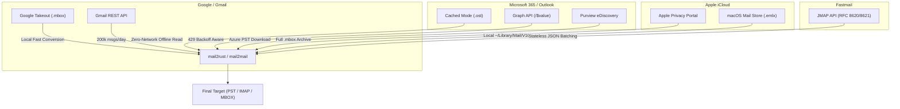

# Alternative Export Pathways (Bypassing IMAP)

While IMAP is ubiquitous, its synchronous TCP model, strict concurrency limits, and daily bandwidth caps make it suboptimal for large-scale mailbox migrations. 

This guide details faster, more reliable alternative pathways: **official bulk archives**, **modern REST/JSON APIs**, and **local client-cache extraction**.

---

## Summary of Alternative Pathways by Provider



---

## 1. Google Gmail & Google Workspace

### Pathway A: Google Takeout (`takeout.google.com`) — Recommended for Bulk
* **How It Works:** Google packages your entire account into one or more multi-gigabyte `.zip` or `.tgz` files containing standard `.mbox` archives (`All mail Including Spam and Trash.mbox`).
* **Advantages:**
  * Completely bypasses the **2.5 GB / day** IMAP bandwidth cap.
  * No risk of temporary account suspension.
  * Preserves Google labels via custom MIME headers (`X-Gmail-Labels: Work, Important, FollowUp`).
* **Processing Takeout Files:**
  `mail2rust` and `mail2mail` can parse the multi-gigabyte MBOX file, inspect the `X-Gmail-Labels`, and reconstitute a full hierarchical folder tree inside a target PST or server:
  ```bash
  # Convert Takeout MBOX directly into an organized PST
  mail2rust convert "All mail Including Spam and Trash.mbox" gmail_archive.pst
  ```

### Pathway B: Gmail REST API (`https://gmail.googleapis.com/gmail/v1/users/me/messages`)
* **When to Use:** When automated programmatic synchronization is required without manual web downloads.
* **Throughput:**
  * Standard project quota: 1,000,000,000 quota units / day (~250 units/second).
  * Fetching full RFC 822 MIME raw content via `users.messages.get(id, format='raw')` costs **5 quota units**.
  * Net capacity: **~200,000 messages per day** (~50x faster than IMAP).

---

## 2. Microsoft 365, Exchange Online & Outlook.com

### Pathway A: Desktop Outlook Cached Exchange Mode (`.ost` Extraction)
If the user already has Microsoft Outlook installed on a workstation:
1. Open Outlook $\rightarrow$ **File** $\rightarrow$ **Account Settings** $\rightarrow$ **Account Settings**.
2. Select the account, click **Change**, ensure **Cached Exchange Mode** is checked, and move the **Download email for the past:** slider to **All**.
3. Allow Outlook to synchronize in the background using its proprietary MAPI/HTTP transport (which is significantly more resilient than IMAP).
4. Locate the local `.ost` file (usually in `%LOCALAPPDATA%\Microsoft\Outlook\*.ost`).
5. Run `mail2rust` to convert the offline OST file directly:
   ```bash
   mail2rust convert "C:\Users\User\AppData\Local\Microsoft\Outlook\user.ost" "user_backup.pst"
   ```
* **Benefits:** Zero server load, zero network bandwidth, 100% fidelity (calendars, tasks, contacts, and rich MAPI properties preserved).

### Pathway B: Microsoft Graph API (`/me/messages`)
* **Endpoint:** `https://graph.microsoft.com/v1.0/me/messages/{id}/$value`
* **Features:**
  * Uses delta queries (`/delta`) to efficiently track additions and deletions.
  * Fetch raw MIME message content directly via the `/$value` endpoint.
  * Returns structured `HTTP 429 Too Many Requests` responses with standard `Retry-After: <seconds>` headers, eliminating unexpected socket disconnects.

### Pathway C: Microsoft Purview eDiscovery (Enterprise / Admin)
* Administrators can run a compliance content search across multiple mailboxes and trigger an export directly into downloadable 64-bit `.pst` files with cryptographic SHA-256 manifests.

---

## 3. Apple iCloud Mail

### Pathway A: Apple Data & Privacy Portal (`privacy.apple.com`)
1. Log into [privacy.apple.com](https://privacy.apple.com/) using the Apple ID.
2. Select **"Request a copy of your data"** $\rightarrow$ check **iCloud Mail**.
3. Apple compiles your complete mailbox into downloadable `.mbox` files.
4. Download and process locally with `mail2rust` or `mail2mail`.

### Pathway B: Local macOS Apple Mail Store Extraction (`.emlx`)
On macOS systems where Apple Mail is configured:
* Messages are stored locally as individual `.emlx` files under:
  ```text
  ~/Library/Mail/V10/<UUID>/<Folder>.mbox/<UUID>/Data/
  ```
* `mail2rust` can read this directory structure natively, converting Apple `.emlx` files directly into `.pst` or `.mbox` with zero network overhead.

---

## 4. Fastmail

### Pathway A: JMAP API (RFC 8620 / 8621) — Recommended
Fastmail was the primary pioneer of the **JSON Meta Application Protocol (JMAP)**.
* **Endpoint:** `https://api.fastmail.com/jmap/api/`
* **Advantages over IMAP:**
  * Runs over standard stateless HTTPS.
  * Batch retrieves up to 500 emails per HTTP request.
  * Can query only specific metadata (`id`, `subject`, `from`, `receivedAt`) before downloading full MIME blobs.
* **Native Tooling:** Use `mail2mail`'s built-in JMAP driver:
  ```bash
  python mail2mail.py jmap --token "fmu1-xxxx" --out fastmail_backup.jmap.json
  ```

### Pathway B: Fastmail Web Export
* Located under **Settings** $\rightarrow$ **Import & Export** $\rightarrow$ **Export**.
* Exports `.zip` archives of `.mbox` files (limited to 4 GB per download batch; larger accounts should export folder-by-folder).

---

## 5. Proton Mail

### Pathway A: Proton Mail Export Tool (Desktop App)
* **Official Utility:** Standalone desktop app developed by Proton for Windows, macOS, and Linux.
* **Mechanism:** Interacts directly with the Proton API, decrypts messages locally using private PGP keys, and outputs clean `.mbox` or `.eml` directory structures.

### Pathway B: Proton Mail Bridge
* Runs a local IMAP/SMTP server on `127.0.0.1:1143`.
* When exporting from Bridge, clamp concurrency to **2 to 4 workers** to prevent the local decryption daemon from saturating system CPU or memory.
