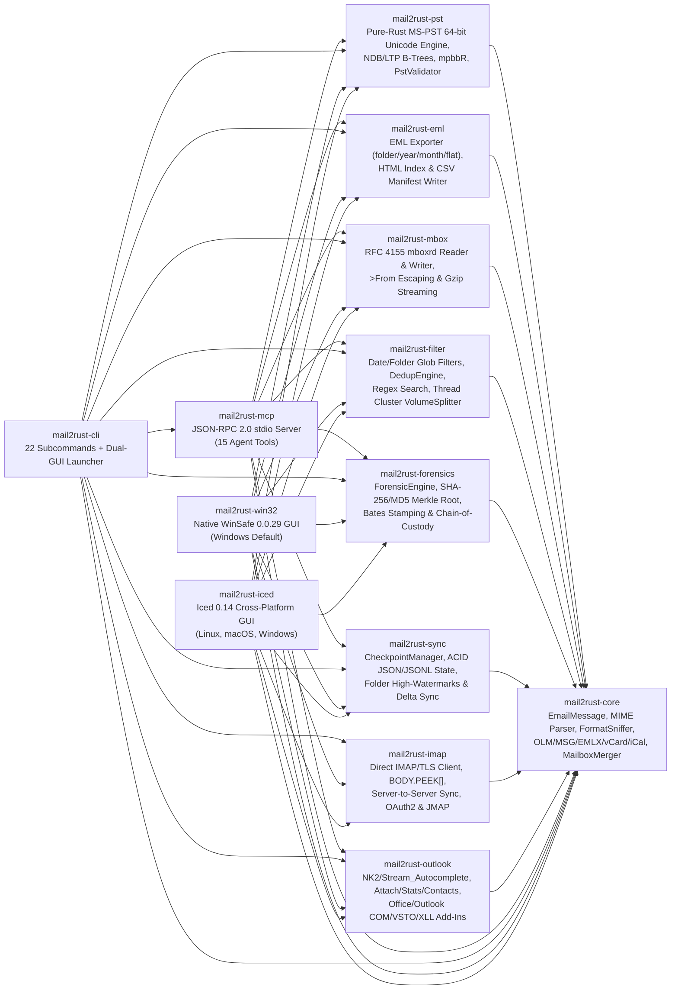

# Workspace Architecture (`mail2rust`)

`mail2rust` is structured as a modular **13-crate Cargo workspace** (`edition = "2024"`, MSRV `1.88`, resolver `2`), integrating shared `guap-kit` infrastructure (`guap-table`, `guap-export`, `guap-mcp`, `guap-gui-*`) while separating RFC/MAPI binary parsing and cryptographic forensics from the CLI, MCP server, and Dual-GUI surfaces.

---

## 1. Domain & Format Crates

1. **`mail2rust-core`**:
   - Core `EmailMessage`, `Attachment`, and `MailboxFormat` data structures.
   - `FormatSniffer`: Inspects leading magic bytes (`!BDN` for PST/OST, `D0 CF 11 E0` for MSG/CFBF, `PK\x03\x04` for OLM/ZIP, `\x1F\x8B` for Gzip, `From ` for MBOX) and directory layouts (`cur/`+`new/` for Maildir, `.sbd`/`.msf` for Thunderbird, `.mh_sequences` for MH).
   - Pure-Rust parsers for RFC 5322 `.eml`, Apple Mail `.emlx` (byte-count prefix + `<plist>` flags), Outlook `.msg` ([MS-CFB] + [MS-OXMSG] MAPI streams), Outlook for Mac `.olm`, vCard `.vcf` (`IPM.Contact`), and iCalendar `.ics` (`IPM.Appointment`).
   - `MailboxMerger`: Multi-source consolidation with cross-archive deduplication and `combine` / `prefix` / `flatten` folder strategies.
2. **`mail2rust-pst`**:
   - Pure-Rust `[MS-PST]` version 23 (64-bit Unicode) NDB (Node Database) and LTP (Lists, Tables, and Properties) reader, writer, and structural validator.
   - Implements 512-byte root header verification, Microsoft `[MS-PST]` CRC-32 calculation, NBT (Node B-Tree) and BBT (Block B-Tree) traversal, Property Context (`0xBC`) and Table Context (`0x7C`) serialization, and `[MS-PST]` §5.1 Permutative (`NDB_CRYPT_PERMUTE`) / Cyclic (`NDB_CRYPT_CYCLIC`) encoding.
3. **`mail2rust-eml` & `mail2rust-mbox`**:
   - `mail2rust-eml`: Exports messages into `folder`, `year`, `month`, or `flat` layouts with Windows-safe filename sanitization, directory sharding (`--max-per-dir`), air-gapped sortable HTML indexes (`--html-index`), and CSV manifests (`--manifest-csv`).
   - `mail2rust-mbox`: Streams `mboxrd` files with reversible `>From ` body line escaping and optional transparent `.mbox.gz` compression.
4. **`mail2rust-filter`, `mail2rust-forensics`, `mail2rust-sync`, `mail2rust-imap`**:
   - `mail2rust-filter`: Date range filtering (`--since` / `--until`), wildcard folder globs, `DedupEngine` (`sha256`, `message-id`, `content`), multi-pattern regex e-Discovery (`MultiPatternMatcher`), and thread-clustering `VolumeSplitter`.
   - `mail2rust-forensics`: Computes per-message SHA-256 and MD5 hashes, sequential Bates stamps (`CASE-2026-0001000`), and root SHA-256 Merkle chain-of-custody certificates.
   - `mail2rust-sync`: Atomic JSON and JSONL checkpoint persistence compatible with `mail2mail` (`CROSS_COMPATIBILITY_SPEC`).
   - `mail2rust-imap`: Native TLS IMAP4rev1 client (`BODY.PEEK[]`), direct in-memory server-to-server `imap-sync`, SASL `XOAUTH2` / `OAUTHBEARER` login, and RFC 8620/8621 JMAP client.

---

## 2. User & Agent Interface Crates

- **`mail2rust-outlook`**: Pure-Rust `.NK2` / `Stream_Autocomplete_*.dat` AutoComplete parser/editor, attachment extractor/stripper, correspondent statistics, OAB/vCard/PST contacts decoder, and COM/VSTO/XLL/WLL/DOTM/OTM Office add-ins inspector (`guap-table` + `guap-export` backed).
- **`mail2rust-cli`**: Unified 22-subcommand binary (`mail2rust`) with two-stage `Ctrl+C` graceful checkpoint shutdown and native GUI dispatching.
- **`mail2rust-win32`**: Native Windows desktop GUI built on **WinSafe `0.0.29`** (Win32 Common Controls v6, zero GPU/WebView2 overhead).
- **`mail2rust-iced`**: Cross-platform pure-Rust GUI built on **Iced `0.14`** (`wgpu` + `tiny-skia` software fallback) for Linux, macOS, and Windows (`mail2rust gui --iced`).
- **`mail2rust-mcp`**: JSON-RPC 2.0 `stdio` Model Context Protocol server (`2024-11-05`) exposing 15 structured email migration, PST validation, Outlook/NK2/Office, search, and forensic tools.

---

## 3. Memory-Safety Boundary (`#![forbid(unsafe_code)]`)

Twelve of the thirteen workspace crates enforce `#![forbid(unsafe_code)]` at the crate root:

| Crate | `unsafe_code` Policy | Role |
| :--- | :--- | :--- |
| `mail2rust-core` | `#![forbid(unsafe_code)]` | RFC 5322, CFBF `.msg`, `.emlx`, `.olm`, `.vcf`, `.ics` parsers & merger |
| `mail2rust-pst` | `#![forbid(unsafe_code)]` | 64-bit Unicode `[MS-PST]` B-Tree reader, writer, cipher & validator |
| `mail2rust-eml` | `#![forbid(unsafe_code)]` | EML tree exporter, air-gapped HTML index & CSV manifest generator |
| `mail2rust-mbox` | `#![forbid(unsafe_code)]` | Streaming `mboxrd` parser & gzip writer |
| `mail2rust-filter` | `#![forbid(unsafe_code)]` | Date/folder filters, regex search, deduplication & thread splitter |
| `mail2rust-forensics` | `#![forbid(unsafe_code)]` | SHA-256/MD5 Merkle root, Bates numbering & audit certificates |
| `mail2rust-sync` | `#![forbid(unsafe_code)]` | Cross-engine checkpoint state & delta calculation |
| `mail2rust-imap` | `#![forbid(unsafe_code)]` | IMAP/TLS streaming, server-to-server sync, OAuth2 & JMAP client |
| `mail2rust-outlook` | `#![forbid(unsafe_code)]` | NK2/AutoComplete, Outlook attachments/stats/contacts & Office add-ins |
| `mail2rust-mcp` | `#![forbid(unsafe_code)]` | JSON-RPC 2.0 `stdio` MCP server |
| `mail2rust-cli` | `#![forbid(unsafe_code)]` | Command-line interface & two-stage signal handler |
| `mail2rust-iced` | `#![forbid(unsafe_code)]` | Cross-platform Iced 0.14 desktop studio |
| `mail2rust-win32` | Restricted to Win32 GUI FFI | Native Windows Common Controls windowing via `winsafe` |
