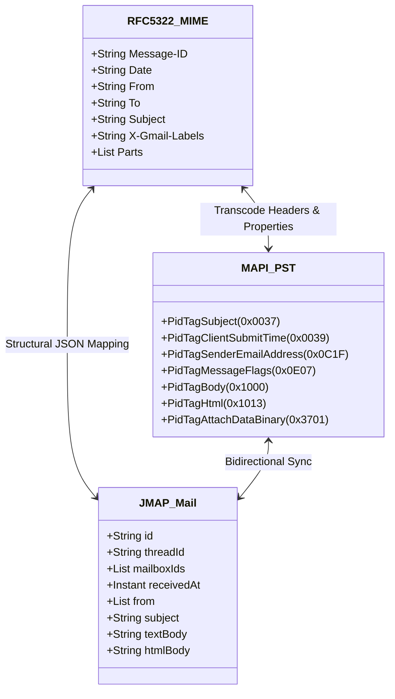

# Mailbox Format Conversion Matrix

`mail2rust` and `mail2mail` provide bidirectional conversion, forensic extraction, and merging across all major enterprise and desktop email formats.

---

## 1. Format Support & Capabilities

| Format | Common Extensions | Source Applications | Read Support | Write Support | Preserves Hierarchy |
| :--- | :--- | :--- | :---: | :---: | :---: |
| **PST (Personal Storage Table)** | `.pst` | Microsoft Outlook (Windows) | ✅ | ✅ | ✅ |
| **OST (Offline Storage Table)** | `.ost` | Microsoft Outlook (Cached Mode) | ✅ | ❌ (Target is PST) | ✅ |
| **MBOX (RFC 4155)** | `.mbox`, `.mbx` | Thunderbird, Apple Mail, Google Takeout | ✅ | ✅ | ⚠️ (Flat or mboxrd) |
| **EML (RFC 5322)** | `.eml` | Windows Mail, Outlook Express, eM Client | ✅ | ✅ | ✅ (Via dir tree) |
| **EMLX** | `.emlx`, `.partial.emlx` | macOS Apple Mail (`~/Library/Mail/`) | ✅ | ✅ | ✅ (Via dir tree) |
| **MSG (CFBF Compound File)** | `.msg` | Microsoft Outlook (Single Item) | ✅ | ✅ | ❌ (Single message) |
| **Maildir** | `cur/`, `new/`, `tmp/` | Dovecot, Postfix, Linux Mail Servers | ✅ | ✅ | ✅ (Dot-folders) |
| **OLM** | `.olm` | Microsoft Outlook for Mac | ✅ | ❌ (Target is PST) | ✅ |
| **JMAP JSON** | `.jmap`, `.jmap.json` | Fastmail, Apache James, Stalwart | ✅ | ✅ | ✅ |

---

## 2. Format Conversion Matrix

The table below shows direct conversion pathways supported by the toolchains:

| Input Format $\downarrow$ \ Output Format $\rightarrow$ | PST | MBOX | EML Directory | Maildir | JMAP JSON |
| :--- | :---: | :---: | :---: | :---: | :---: |
| **PST** | — | Direct | Direct | Direct | Direct |
| **OST** | Direct | Direct | Direct | Direct | Direct |
| **MBOX** (e.g. Google Takeout) | Direct | — | Direct | Direct | Direct |
| **EML Directory** | Direct | Direct | — | Direct | Direct |
| **EMLX Directory** (macOS) | Direct | Direct | Direct | Direct | Direct |
| **OLM** (Mac Outlook) | Direct | Direct | Direct | Direct | Direct |
| **Maildir** | Direct | Direct | Direct | — | Direct |
| **JMAP JSON** | Direct | Direct | Direct | Direct | — |

---

## 3. High-Fidelity Metadata Mapping

When converting between formats, the engine maps proprietary properties into standard RFC headers and vice-versa:



### Critical Property Translations:
* **Read / Unread State:**
  * MAPI: `PidTagMessageFlags & 0x0001 == 0` (Unread) vs `1` (Read).
  * IMAP: `\Seen` flag in flags list.
  * JMAP: `"keywords": { "$seen": true }`.
* **Timestamps:**
  * RFC 5322: `Date:` header (e.g., `Wed, 07 Nov 2026 20:48:28 -0500`).
  * MAPI: 64-bit Windows FILETIME (100-nanosecond intervals since January 1, 1601).
  * JMAP: ISO 8601 UTC timestamp (`2026-11-08T01:48:28Z`).

---

## 4. Multi-Mailbox Merging

Both `mail2rust` and `mail2mail` can merge multiple disparate sources (e.g., a Google Takeout MBOX, an Apple Mail `.emlx` archive, and an Outlook `.ost` cache) into a single, unified, de-duplicated PST file:

```bash
# Merge MBOX, EML directory, and OST into a unified PST with deduplication
mail2rust merge \
  --input "takeout.mbox" \
  --input "C:\Users\User\MailArchive\" \
  --input "outlook_cache.ost" \
  --dedup message-id \
  --out "consolidated_archive.pst"
```
