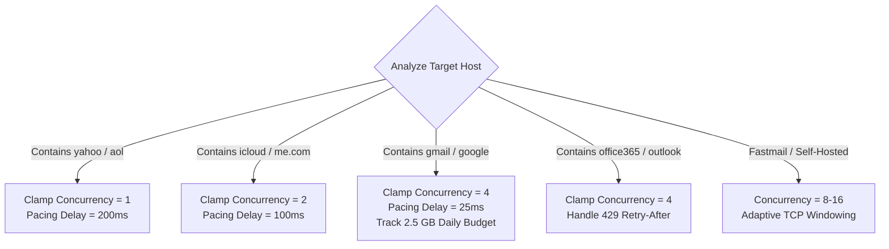
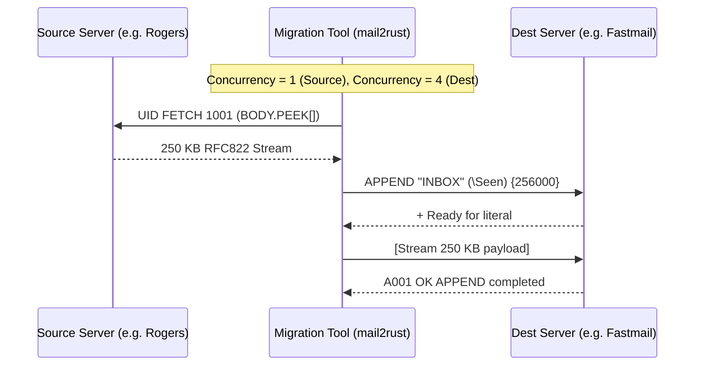

# Migration Best Practices & Client-Side Tuning

When engineering high-throughput migration utilities such as `mail2rust` and `mail2mail`, relying on standard default IMAP settings leads to connection dropped sockets, rate-limit lockouts, and corrupted local state.

This guide provides engineering patterns and client-side tuning configurations to maximize throughput while staying under provider abuse radars.

---

## 1. Concurrency Clamping & Dynamic Worker Scaling

Never allow users to open arbitrary numbers of concurrent worker threads. Concurrency must be clamped dynamically based on the target hostname:



### Reference Host Configuration Table

| Hostname Pattern | Max Concurrent Workers | Batch Size (UIDs) | Pacing Delay | Safety Strategy |
| :--- | :--- | :--- | :--- | :--- |
| `*.yahoo.com`, `*.aol.com` | **1** (Strict) | 50 | 200 ms | Use `export.imap.mail.yahoo.com` |
| `*.mail.me.com`, `*.icloud.com` | **2** | 50 | 100 ms | Watch for `421` dropped sockets |
| `*.gmail.com` | **4** | 100 | 50 ms | Stop when approaching 2.5 GB/day |
| `*.office365.com` | **4** | 100 | 25 ms | Respect Graph `Retry-After` if available |
| `127.0.0.1` *(Proton Bridge)* | **2–4** | 50 | 0 ms | Prevent local GPG RAM exhaustion |
| *Self-hosted (Dovecot/Postfix)* | **8–16** | 250 | 0 ms | High-throughput streaming |

---

## 2. Non-Destructive Message Inspection (`BODY.PEEK[]`)

A catastrophic bug in naive IMAP migration tools is fetching message content using `BODY[]` or `RFC822`:

```text
# ❌ INCORRECT: Implicitly sets the \Seen flag on the remote server
C: A001 UID FETCH 105 (BODY[])
C: A002 UID FETCH 106 (RFC822)

# ✅ CORRECT: Pure read-only inspection; preserves original user read/unread flags
C: A001 UID FETCH 105 (BODY.PEEK[])
C: A002 UID FETCH 106 (RFC822.PEEK[])
```

* `BODY[]` alters server-side state. If a user has unread messages, migrating with `BODY[]` marks them all as read.
* `BODY.PEEK[]` fetches full MIME bytes non-destructively, leaving the `\Seen` flag unchanged.

---

## 3. Adaptive Exponential Backoff with Jitter

When a server signals rate limiting (e.g. `421`, `NO [LIMIT]`, `Server Busy`, `[ALERT]`), clients must back off exponentially rather than immediately reconnecting.

### Mathematical Formulation
To prevent the "thundering herd" problem where synchronized threads retry simultaneously, add random full jitter:

$$T_{\text{sleep}} = \min(T_{\text{max}}, 2^{\text{attempt}} \cdot T_{\text{base}}) + \text{uniform}(0, T_{\text{jitter}})$$

Where:
* $T_{\text{base}} = 2.0\text{ seconds}$
* $T_{\text{max}} = 300\text{ seconds}$ (5 minutes)
* $T_{\text{jitter}} = 3.0\text{ seconds}$

### Rust Implementation Pattern
```rust
use std::time::Duration;
use rand::Rng;

pub async fn execute_with_backoff<F, T, E>(mut op: F) -> Result<T, E>
where
    F: FnMut() -> Result<T, E>,
{
    let mut attempt = 0;
    let max_attempts = 6;
    let base_delay = 2.0;

    loop {
        match op() {
            Ok(val) => return Ok(val),
            Err(e) => {
                attempt += 1;
                if attempt >= max_attempts {
                    return Err(e);
                }
                let exp_backoff = base_delay * (2.0_f64.powi(attempt));
                let jitter: f64 = rand::thread_rng().gen_range(0.0..3.0);
                let sleep_duration = Duration::from_secs_f64((exp_backoff + jitter).min(300.0));
                
                eprintln!("[WARN] Rate limited. Backing off for {:.2}s...", sleep_duration.as_secs_f64());
                tokio::time::sleep(sleep_duration).await;
            }
        }
    }
}
```

---

## 4. Discrete UID Range Paging

Never issue an open-ended `FETCH 1:*` on folders with thousands of messages. Instead:
1. Issue `UID SEARCH ALL` to obtain a sorted array of message IDs.
2. Slice the array into chunks of 50 to 100 UIDs.
3. First query metadata in batch:
   ```text
   A001 UID FETCH 1001:1050 (UID RFC822.SIZE FLAGS INTERNALDATE)
   ```
4. Then fetch message content individually or in small chunks:
   ```text
   A002 UID FETCH 1001:1010 (BODY.PEEK[])
   ```

---

## 5. Streaming vs In-Memory Buffering

When converting large mailboxes (e.g., 50 GB MBOX $\rightarrow$ PST), loading the entire mailbox into RAM results in out-of-memory (OOM) crashes.

* **Stream Ingestion:** Read MBOX line-by-line using a streaming buffer. Split messages at `^From ` envelope separators.
* **Direct Disk Flush:** Write message nodes to the target format (PST/Maildir) and flush buffers periodically.
* **De-duplication Cache:** Maintain an in-memory or SQLite index of `(Message-ID, SHA-256(Body))` hashes to skip already-migrated items on restart.

---

## 6. Server-to-Server Streaming (Zero Local Storage)

When migrating directly between two cloud providers (e.g. Gmail $\rightarrow$ Fastmail or Rogers $\rightarrow$ Microsoft 365), avoid saving intermediate files to disk:



* Eliminates disk I/O bottlenecks.
* Supports resume via UID / Message-ID checkpoints.
* Handles format transcoding (e.g. adding missing `Date:` or `Message-ID:` headers on the fly).
