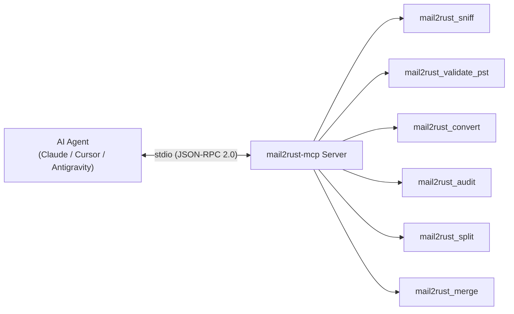

# Model Context Protocol (MCP) Integration Guide

The **Model Context Protocol (MCP)** is an open standard designed by Anthropic to enable LLM agents (e.g. Claude Desktop, Cursor, Google Antigravity, Windsurf, AutoGPT) to seamlessly invoke native local capabilities and data pipelines.

`mail2rust` includes a production-grade, zero-dependency MCP server that exposes the complete offline email migration, forensic auditing, and MS-PST binary engine as native agent tools over standard JSON-RPC 2.0 (`stdio`).

---

## 1. Native Tools Architecture

All tools communicate over standard I/O using newline-delimited JSON-RPC 2.0 messages. All diagnostic logs and internal traces are strictly redirected to `stderr`, guaranteeing that `stdout` remains pure, valid JSON-RPC at all times.



### Available Tools

| Tool Name | Purpose | Parameters | Output Schema |
| :--- | :--- | :--- | :--- |
| **`mail2rust_sniff`** | Classifies mailbox formats and magic byte signatures (PST, OST, MBOX, EML, EMLX, MSG, OLM, Maildir). | `path`: string | `format`, `size_bytes`, `is_directory`, `recommended_action` |
| **`mail2rust_validate_pst`** | Inspects MS-PST containers: checks 512-byte header, `!BDN` magic, CRC-32 integrity, and NBT/BBT B-Trees without Microsoft Outlook. | `path`: string | `is_valid`, `magic`, `client_magic`, `version`, `encryption_method`, `crc_match` |
| **`mail2rust_convert`** | High-throughput format conversion (e.g. MBOX to PST, PST to EML tree, EML to PST) with optional deduplication. | `source`, `destination`, `target_format`, `dedup` | `status`, `messages_ingested`, `messages_written`, `duplicates_skipped`, `elapsed_ms` |
| **`mail2rust_audit`** | Forensic chain-of-custody examination: calculates SHA-256 Merkle root, applies Bates stamping, and produces a forensic CSV manifest. | `path`, `case_number`, `examiner`, `bates_prefix`, `output_csv` | `case_number`, `total_items`, `root_sha256`, `bates_start`, `bates_end`, `manifest_csv` |
| **`mail2rust_split`** | Breaks oversized archives (>20GB or >50GB) into chunked volume files while preserving conversation threads and folder trees. | `source`, `destination_dir`, `max_volume_mb`, `strategy`, `target_format` | `status`, `volumes_count`, `volumes` (array of created parts with counts and sizes) |
| **`mail2rust_merge`** | Merges multiple disparate archives into a unified container with cross-archive SHA-256 deduplication. | `sources` (array), `destination`, `dedup` | `sources_merged`, `total_input_messages`, `total_unique_messages`, `total_duplicates_removed` |

---

## 2. Server Installation & Execution

### Running via `mail2rust` CLI
If you already have `mail2rust` installed, launch the MCP server directly:
```bash
mail2rust mcp
```

To inspect the raw JSON schemas of all registered tools:
```bash
mail2rust mcp --tools
```

### Running Standalone Binary (`mail2rust-mcp`)
```bash
cargo install --path crates/mail2rust-mcp
mail2rust-mcp
```

---

## 3. Client Configuration

### Claude Desktop
Edit `%APPDATA%\Claude\claude_desktop_config.json` (Windows) or `~/Library/Application Support/Claude/claude_desktop_config.json` (macOS):
```json
{
  "mcpServers": {
    "mail2rust": {
      "command": "mail2rust",
      "args": ["mcp"],
      "env": {
        "RUST_LOG": "warn"
      }
    }
  }
}
```

### Cursor IDE
Add to your project's `.cursor/mcp.json` or Global Settings:
```json
{
  "mcpServers": {
    "mail2rust": {
      "command": "mail2rust-mcp"
    }
  }
}
```

### Google Antigravity / Gemini CLI
Add to `antigravity.json`:
```json
{
  "mcpServers": {
    "mail2rust": {
      "command": "mail2rust",
      "args": ["mcp"]
    }
  }
}
```

---

## 4. Smithery.ai Registry Manifest

`mail2rust` includes a root-level `smithery.yaml` manifest for automatic agent indexing on the [Smithery.ai](https://smithery.ai) registry:

```yaml
name: mail2rust-mcp
version: "3.3.0"
description: "Universal offline email migration, forensic auditing, and MS-PST binary engine in 100% pure Rust"
repository: "https://github.com/adpaolucci/mail2rust"
license: "MIT OR Apache-2.0"

entrypoint:
  type: stdio
  command: mail2rust-mcp

build:
  type: cargo
  crate: mail2rust-mcp
```

---

## 5. Example Interaction via MCP

### Agent Question:
> *"Can you inspect `/evidence/archive.mbox`, convert it to a 64-bit Outlook PST file with Bates stamping prefix `CASE-2026`, and verify that the resulting PST passes Microsoft specification checks?"*

### Tool Calls Executed by the Agent:
1. **`mail2rust_sniff`**:
   ```json
   { "path": "/evidence/archive.mbox" }
   ```
   *Response*: Confirmed `MBOX` format (`12.4 MB`, 420 messages).
2. **`mail2rust_convert`**:
   ```json
   {
     "source": "/evidence/archive.mbox",
     "destination": "/evidence/output.pst",
     "target_format": "pst",
     "dedup": true
   }
   ```
   *Response*: Ingested 420 messages, wrote 418 unique messages (2 duplicates skipped), elapsed time `18 ms`.
3. **`mail2rust_validate_pst`**:
   ```json
   { "path": "/evidence/output.pst" }
   ```
   *Response*: `is_valid: true`, `magic: 0x4E44424E (!BDN)`, `crc_match: true`, `version: 23`.
4. **`mail2rust_audit`**:
   ```json
   {
     "path": "/evidence/output.pst",
     "case_number": "CASE-2026-001",
     "bates_prefix": "CASE-2026",
     "output_csv": "/evidence/manifest.csv"
   }
   ```
   *Response*: Bates range `CASE-2026-0001000` to `CASE-2026-0001417`, Root SHA-256 verified.
